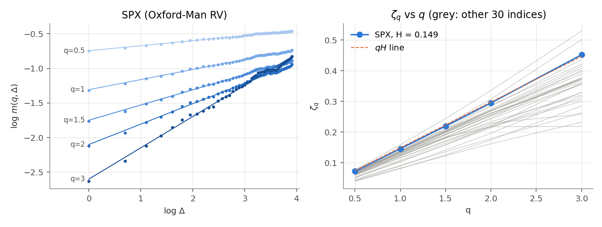
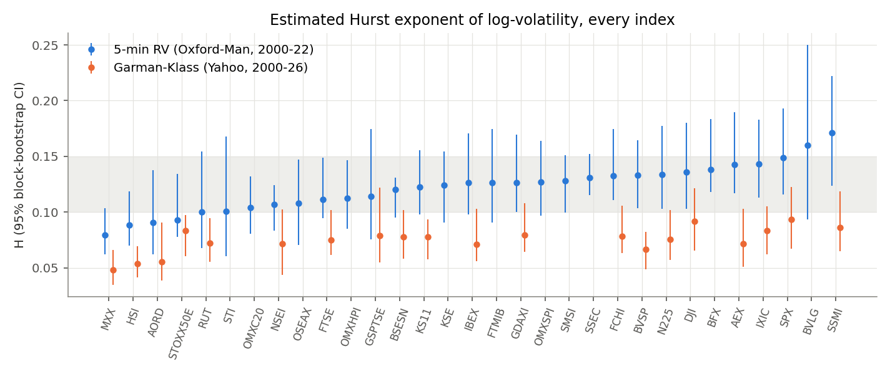
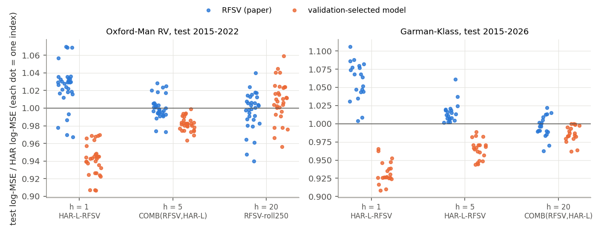

# Volatility is rough: replication and forecasting

A replication of Gatheral, Jaisson & Rosenbaum, *Volatility is Rough* (Quantitative Finance 18(6), 2018;
[arXiv:1410.3394](https://arxiv.org/abs/1410.3394)) on **31 equity indices**, plus a walk-forward
forecasting competition between the paper's RFSV predictor, HAR, GARCH and a random walk, and
validation-selected improvements.

Report: [`report/report.pdf`](report/report.pdf) (7 pages). Notebook: [`notebooks/rough_vol.ipynb`](notebooks/rough_vol.ipynb).

## Data

| Type | Source | Indices | Period | Used as |
|---|---|---|---|---|
| **RV**: 5-minute realized variance (`rv5`) + open-to-close returns | Oxford-Man Institute Realized Library, final public version, via the Internet Archive copy of the official zip: <https://web.archive.org/web/20220301022212id_/https://realized.oxford-man.ox.ac.uk/images/oxfordmanrealizedvolatilityindices.zip> | 31 | 2000-01-03 to 2022-02-25 | main data set |
| **GK**: Garman-Klass range variance (Parkinson as a check) + close-to-close returns | Yahoo Finance daily OHLC through `yfinance` | 20 | 2000-01 to 2026-10-12 | extension to 2026 |

**Licences.** The Oxford-Man Realized Library (Heber, Lunde, Shephard & Sheppard, 2009, version 0.3) was
free for academic research with citation of that reference; it has no open licence and the library was
discontinued in 2022, so the data are **not** included in this repository; `scripts/download_data.py`
fetches the archived zip. Yahoo Finance data are subject to Yahoo's terms of use (personal / research use);
`yfinance` itself is Apache-2.0. Neither data set is redistributed here.

The two data types are **never mixed** in one series. Every table reports RV and GK separately.

## Results

### 1. Roughness (H)

| | indices | median H | range | share in [0.10, 0.15] | S&P 500 |
|---|---|---|---|---|---|
| RV (Oxford-Man, 2000-2022) | 31 | **0.126** | 0.079-0.171 | 25 / 31 | 0.149 (s.e. 0.021) |
| GK (Yahoo, 2000-2026) | 20 | 0.077 | 0.048-0.094 | 0 / 20 | 0.094 (s.e. 0.014) |

Standard errors: block bootstrap, 250-day blocks, 500 draws. Full table: `results/h_table.csv`.

* The paper's finding holds: log m(q, Δ) is linear in log Δ, ζ_q is linear in q (ζ_q ≈ qH), and H ≈ 0.1-0.15 on almost every index.
* Increments are close to Gaussian in the body but have fat tails on RV (median excess kurtosis 2.1 at Δ = 1, 0.8 at Δ = 125).
* Smoothing bias (simulation): daily integration biases H **up** (true 0.10 is estimated at about 0.20); measurement noise biases it **down**. That is why the noisier GK proxy gives lower H than RV.




### 2. Forecasting (held-out test period, 2015 onwards)

Walk-forward, no look-ahead (verified by an automated perturbation test). Burn-in 1000 days; validation =
targets up to 2014-12-31; test = origins from 2015-01-01 (to 2022-02 for RV, 2026-10 for GK). Entries are
the test-period log-MSE relative to HAR, geometric mean over indices (below 1 = better than HAR).

| | RV h=1 | RV h=5 | RV h=20 | GK h=1 | GK h=5 | GK h=20 |
|---|---|---|---|---|---|---|
| Random walk | 1.338 | 1.391 | 1.444 | 1.499 | 1.564 | 1.600 |
| GARCH(1,1) | 1.333 | 1.179 | 1.152 | 1.154 | 1.106 | 1.118 |
| HAR | 1.000 | 1.000 | 1.000 | 1.000 | 1.000 | 1.000 |
| RFSV (paper) | 1.024 | 1.001 | 0.996 | 1.059 | 1.015 | 0.996 |
| **Selected on validation** | **0.941** | **0.982** | 1.008 | **0.933** | **0.965** | **0.986** |
| selected model | HAR-L-RFSV | COMB(RFSV, HAR-L) | RFSV-roll250 | HAR-L-RFSV | HAR-L-RFSV | COMB(RFSV, HAR-L) |
| beats HAR / beats RFSV (indices) | 31/31, 31/31 | 31/31, 30/31 | 8/31, 1/31 | 20/20, 20/20 | 20/20, 20/20 | 19/20, 20/20 |

* **RFSV vs HAR**: RFSV is *worse* than HAR at 1 day (significantly worse on 17 of 31 RV indices, Diebold-Mariano 5%), level at 5 days and only marginally better at 20 days (not significant on any index). For the S&P 500 alone it does beat HAR at 1 day (0.967).
* **Improvement**: the validation-selected model beats both HAR and RFSV at 1 and 5 days on both data sets (significantly on most indices), and at 20 days on GK. At 20 days on RV the selected model (rolling-window RFSV) **fails** on the test period.
* Most of the short-horizon gain comes from the **leverage** term (HAR-L alone: 0.954 / 0.987 / 0.992 on RV); adding the RFSV forecast as a regressor improves this further (HAR-L-RFSV 0.941 / 0.973 / 0.975).
* **QLIKE** (variance level): the selected models beat HAR at 1 and 5 days; at 20 days the calibrated GARCH has the best QLIKE (0.983 RV, 0.950 GK) and RFSV is worse than HAR (1.079 RV).

Full tables: `results/test_headline.csv`, `results/loss_table.csv`, `results/dm_counts.csv`, `results/test_per_index.csv`.



## Models

* **RW**: log v̂(t+h) = log v(t).
* **HAR** (Corsi 2009) on log variance, direct h-step, refitted daily by OLS on all past pairs whose target is observed.
* **GARCH(1,1)** on returns, refitted every 20 days, level calibrated on past data.
* **RFSV** (GJR 2018): E[log v(t+h) | F_t] = cos(Hπ)/π · h^{H+1/2} ∫ log v(s) / ((t−s+h)(t−s)^{H+1/2}) ds, truncated at 500 days; variance forecast exp(E[log v] + 2c(H)ν²h^{2H}). H, ν re-estimated every 20 days on past data only.
* Candidates for improvement: rolling-window H (250/500/1000 days), HAR-L (leverage), HAR-RFSV, HAR-L-RFSV, and real-time combinations COMB(RFSV, HAR) and COMB(RFSV, HAR-L). One per horizon chosen on validation.
* Tests: Diebold-Mariano with Bartlett HAC variance. A Model Confidence Set was not run (pairwise DM instead).

## Layout

```
src/data.py          loaders, Garman-Klass / Parkinson
src/estimation.py    m(q,Δ), ζ_q, H, block bootstrap, Gaussianity, fBm simulation
src/models.py        RW, HAR(-L), GARCH, RFSV predictor, combinations (all real-time)
src/evaluation.py    walk-forward runner, losses, DM tests, validation selection, look-ahead check
scripts/             download_data.py, build_data.py, run_forecasts.py, make_notebook.py, make_tables.py
notebooks/rough_vol.ipynb   end-to-end notebook, saved with outputs
report/report.tex|pdf       7-page report
results/, figures/          outputs
```

## How to run

```bash
python -m pip install --user -r requirements.txt
python -I scripts/download_data.py        # data/raw/ (Oxford-Man zip + Yahoo OHLC)
python -I scripts/build_data.py           # data/processed/
python -I scripts/run_forecasts.py        # results/forecasts_*.parquet (about 3 minutes, 6 processes)
cd notebooks && jupyter nbconvert --to notebook --execute --inplace rough_vol.ipynb
cd .. && python scripts/make_tables.py && cd report && pdflatex report.tex && pdflatex report.tex
```

The notebook itself calls `build_data.py` and `run_forecasts.py` (set `RUN_PIPELINE = False` to reuse
results). Downloaded files are treated as untrusted data: they are parsed only by scripts run with `python -I`.
